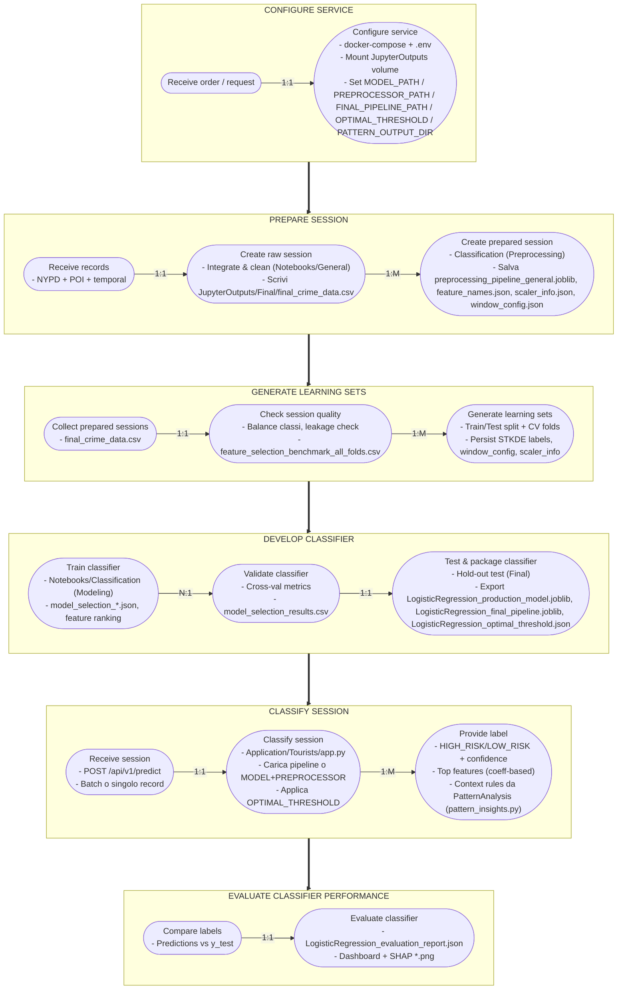

## Process Landscape — Crime Analyzer (Tourist Classifier)

This diagram riassume il flusso end‑to‑end del progetto, seguendo la struttura dell'immagine fornita e mappandola agli artifact presenti nella repo (preprocessing, modeling, tuning, API di predizione).

> Riferimenti chiave in repo
> - Preprocessing e integrazione dati: `Notebooks/General`, `Notebooks/Classification` → output in `JupyterOutputs/Classification (Preprocessing)/`
> - Model selection/tuning/test: `Notebooks/Classification` → output in `JupyterOutputs/Classification (Modeling|Tuning|Final)/`
> - Pattern mining per insight: `Notebooks/PatternAnalysis` + `tools/pattern_analysis_profile.py` → output in `JupyterOutputs/PatternAnalysis/`
> - Servizio inference: `Application/Tourists/app.py` (FastAPI) + `pattern_insights.py`

Note:
- Gli step e gli artefatti citati corrispondono a file/cartelle già presenti in `JupyterOutputs/` (es. `preprocessing_pipeline_general.joblib`, `feature_names.json`, `LogisticRegression_production_model.joblib`, `LogisticRegression_optimal_threshold.json`).
- Gli insight contestuali (regole per BORO_NM/TIME_BUCKET) provengono da `JupyterOutputs/PatternAnalysis/` (`rule_catalog.json`, `global_insights.txt`, file per borough/time bucket) e sono caricati da `pattern_insights.py`.
- Il servizio FastAPI restituisce anche spiegazioni (top features) e trend contestuali (regole per BORO_NM/TIME_BUCKET) tramite `pattern_insights.py`.
